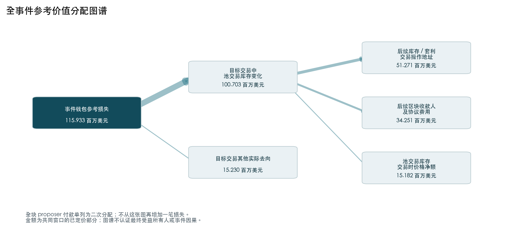
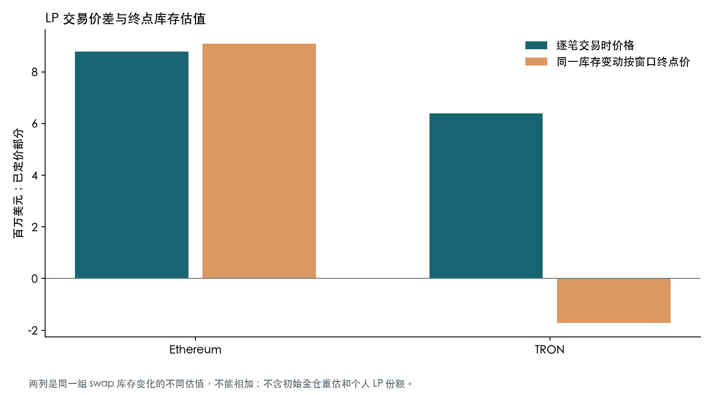

# 全事件统一分配与真实收支核验

这次将库存型交易、代币承接、TRON、LP 和区块付款放入同一套可复算账表。共同窗口为 **2026-10-29 20:30:00 至 2026-10-30 07:00:00 UTC，左闭右开**。Ethereum 与 TRON 使用同一个时钟，纽约时间为 10 月 29 日 16:30 至次日 03:00。

主表的事件钱包参考损失已定价部分为 **$115,933,224.16**，非事件钱包及协议的有符号分配已定价部分为 **$115,933,224.16**，对账差 **0E-34 美元**。834 笔目标交易的事件钱包原币变化均已获得合约匹配历史报价。对手方未定价凭证仍按原币逐项保留。本范围的目标交易参考损失已经按所列报价算出；参与者分类中尚未定价的凭证不以零值当作确定利润，市场参考损失也不被解释为全事件因果 MEV。

目标集合采用项目归档的钱包、直接资金关联、订单及已识别 swap 清单；资金关联不等于同一受益所有人认证。Bitquery 未公开完整逐笔全集，本项目没有声称已对齐它的全部交易清单。所有“完整”均指上述明确集合及共同窗口。

## 统一分配表

| 角色 | 目标交易初始变化 | 后续关联再分配 | 合计（已定价部分） | 未定价资产行 |
|---|---:|---:|---:|---:|
| LP / 协议池交易库存 | $100,703,193.78 | $-85,521,598.09 | $15,181,595.69 | 4690 |
| Manager / hook 结算余项 | $0.00 | $0.00 | $0.00 | 0 |
| 其他实际地址有符号变化 | $5,248,916.51 | $0.00 | $5,248,916.51 | 0 |
| 区块收款人（含 priority） | $3,956,272.12 | $31,927,909.30 | $35,884,181.42 | 0 |
| 池非交易本金 / 协议现金 | $0.00 | $0.00 | $0.00 | 0 |
| 代币发行 / 销毁记账端 | $-6,983.72 | $0.00 | $-6,983.72 | 18 |
| 包装合约储备变化 | $-472,554.69 | $0.00 | $-472,554.69 | 0 |
| 订单 filler / resolver 操作边界 | $6,479,475.32 | $0.00 | $6,479,475.32 | 0 |
| 以太坊协议费用销毁 | $24,868.98 | $2,284,794.96 | $2,309,663.94 | 0 |
| 后续库存 / 套利交易操作地址 | $0.00 | $51,270,900.66 | $51,270,900.66 | 4172 |
| 借贷协议本金调整后变化 | $0.00 | $0.00 | $0.00 | 0 |
| TRON 实付资源费 | $35.86 | $37,993.18 | $38,029.04 | 0 |

正数表示获得的资产、仓位或参考价差，负数表示付出的资产或成本。代币发行/销毁端是记账端，不能叫获利钱包。包装合约、借贷协议和池的本金变化有各自角色。主表的“库存/套利交易操作地址”按支付 Gas 的地址归属，属于池交易参考价差；实际钱包收支另表列示，不能据此认定企业所有权。

## 怎么算“赚了多少钱”

目标交易使用完整的实际地址账：原生币、ERC20、V4 底层币种 claim 与 manager 对应负债、已识别借贷本金变动、实付费用。原始整数逐资产守恒。WETH/ETH、WTRX/TRX 的包装背书做一次消重。Aave/JustLend 新增借款作为负债调整；最大 Comet resolver 使用已经验证的历史抵押和债务变化。其他未完整识别的借贷/仓位情形保留风险标识。

后续交易的主表取**已经被目标交易触及的同一池 / PoolId 的 swap 资产变化**，按交易时共同市场价计算。操作地址参考价差 = 该池向交易方交付的参考价值 − 本笔实际区块收款变化 − 协议费用。多个池或多个 swap 的同一笔交易只计一次费用。正收益、负收益和有证据的失败尝试均保留。其他池的对冲腿、借贷本金和 LP 充值不被偷偷并为本次事件产生的收入；这些实际变化保存在独立全地址总账。

因此，本表可回答“谁在事件池交易中捕获了多少参考价差、实际付了多少链上费用、资产实际记到什么地址”，同时提供实际 Gas 地址变化及未归属失败费用敏感性。它没有掌握全部历史库存取得成本、链下对冲、企业内全部账户、能源租赁付款或税费，不能把池卖出价差改称企业最终净利润。已有 **2,483 个真实闭合正收益套利单元、244.618801770585241269 ETH 净留存**作为结构证据保留；它们会与本表交易重合，禁止再次相加。

## MEV 的明确判据

1. **已闭合多池套利**：实际存在不同池的路线，资产流及底层币种闭合，在已识别操作边界扣除真实链上成本后仍有正盈余。Gas 高低不是这个判据。
2. **库存型参考价差**：在偏离市场价的事件池卖出库存或承接代币，逐笔按共同市场价估值。它证明成交价差，单凭这一点不能证明历史成本利润或因果 MEV。
3. **排序竞价付款**：真实 priority 或真实转账 / claim 支付给区块收款人。付款本身不证明夹子或抢跑。
4. **事件相关性**：同一经过身份核验的池 / PoolId，发生在其首笔目标交易之后。目标之前为对照；同一交易里的其他池是执行背景。
5. **因果增量**：只接受历史状态重放里指定删除/重排方案的可执行比较，并保留失败及不变结果。已有逐块重放结果属于单独证据层，不能把所有同池交易或全块付款都宣布为本次事件造成。

## LP：交易时价格与终点库存要分开

| 链 | 逐笔交易时估值 | 同一 swap 库存变化按 07:00 终点价 | 交易时有价格缺口的池记录数 |
|---|---:|---:|---:|
| ethereum | $8,781,451.77 | $9,091,482.69 | 2345 |
| tron | $6,400,143.92 | $-1,714,649.32 | 0 |

终点列取相同 swap 原币向量，以窗口结束时已经完成的一分钟行情重估。在保持非交易本金流不变的假设下，它衡量 swap 库存变化相对保留相同初始币种的差额；不把初始全部资产的市场涨跌归给黑客，不包含无法确认的个人 LP 份额，也不把 LP 领取本金再加作利润。LP 与协议收费的归属在未取得 fee-growth/份额证据时保持合并。两种估值不能相加。

TRON 三个池的结果分开列示，比较主池与多池总额时应先对齐池集合、窗口和报价：

| TRON 池 / PoolId | 交易时价格净额 | 终点价库存变化 |
|---|---:|---:|
| TSUUVjysXV8YqHytSNjfkNXnnB49QDvZpx | $5,900,125.85 | $625,151.18 |
| TVjuTE3V5bMVdpfNhid8kD2v35T2k1u1Br / dda1d5819853f19f3e952da5d93aa2d572d95c72a8e6e4c2acab65384fd2557e | $663,844.97 | $-2,051,204.15 |
| TFGDbUyP8xez44C76fin3bn3Ss6jugoUwJ | $-163,826.90 | $-288,596.35 |

## 区块与 proposer：付款确认和事件归属是两件事

共同窗口内，**2,794 个区块、2,901 条实际付款 trace** 已核对，proposer 全块实际收到 **10863.086055333344617361 ETH**。逐块 trace 金额与归档 relay 付款一致。

这些付款列入二次分配表，主表追加提取额为 **0**。主表先计关联交易付给区块收款人的实际变化；builder 随后转给 proposer 的同一笔价值再加一次会重复。全块还包含其他交易、原有余额和其他资金来源，因此 proposer 款的事件份额列为“未识别”，不是观测值 0；逐块给出 0 至该块实际付款的识别范围。没有使用任意比例把整块付款归给本次事件，也没有把“匹配到了 relay”当作因果证明。

## 价格口径、Bitquery 对照与价格缺口

主口径对所有正负项使用同一资产、同一交易分钟的**上一完整分钟收盘价**。币种映射按合约身份与小数位核验；优先使用 Coinbase 独立现货，补充经过同一合约映射的 Binance 现货，并用真实 USDT/USD 换算。完成分钟缺口最多回取 5 分钟。精确合约的 DefiLlama 二级报价最多陈旧 600 秒，逐项标注可能依赖池价，不能将 confidence 值解释为独立公允价证明。无合格报价保留原币及空白金额。

独立的 USDT/USDC/DAI = 1 美元敏感性仍保持同一前一分钟时钟；其事件钱包参考损失已定价部分为 **$116,567,771.38**。主账与敏感性账不混用。

[Bitquery 原研究](https://bitquery.io/investigations/binance-hack-who-profited)报告约 1.19 亿美元参考损失、交易者约 5,990 万、builder/validator 约 2,950 万、LP 约 2,020 万及订单方约 670 万美元。它采用同分钟 Hyperliquid、稳定币按 1 美元、不同链/交易类型的截止时刻，且卖出腿价差未包含其他场所的库存买入成本。我们的主表覆盖共同截止 07:00 的有符号交易，用独立现货及实际稳定币汇率，保留了自然交易和成本对照；两套总额不能直接解释为复现误差或真实因果差异。

TRON 已另做可复算市场敏感性：取得 44 根 Hyperliquid 15 分钟历史行情；窗口内开盘 0.33136、最高 0.36489、末根收盘 0.33857。这能交叉检查价格路径。公开接口没有提供对应的一分钟历史，15 分钟上一完整柱及当前柱收盘敏感性均单列，后一种明确含回看偏差，不冒称 Bitquery 一分钟精确复现。

## 全块实际结算层与同一张分阶段总表

完整总表：[主分配与实际结算统一总表 CSV.gz](all_stages_allocation.csv.gz)。`stage` 区分有符号参考价值分配和真实转账，二次结算的 `primary_additive_USD` 一律为 0；同一笔价值经过中介时保留每条真实转账，但不把这些转账累加为事件损失。

在共同窗口的全部 **3,138** 个区块，另外重建了 **53,238** 条区块收款人 / proposer 付款交易相关的实际原生 ETH 转账，逐块与原始资金流及已匹配的 proposer 金额核对。区块收款人向已知交易操作地址或操作边界、且发生在主预算交易之外的实际付款为 **$1,276.78**；地址对应关系保留，不把这些款自动解释为事件退款。

全块区块收款人的原生币执行余额变动代理为 **5655.153199117010395497 ETH**。它覆盖同期全部交易，且不等于企业最终利润；ERC20 仓位、其他资金来源、共识提取和链外账户另外存在。主表的“区块收款人”是接收环节，后续真实转出在此结算层逐笔列示。

| 区块收款人实际转出接收方 | 实收 ETH | 转账条数 |
|---|---:|---:|
| 0xfeeeeee44046c3f61a8cc081e0918ef0de0a7ffc | 10635.016603253942048065 | 8722 |
| 0x388c818ca8b9251b393131c08a736a67ccb19297 | 591.446695397230396692 | 27 |
| 0x397b28d85d77fef1576e129bb35b322c2bee1ba1 | 302.696296928913744749 | 28 |
| 0x6be457e04092b28865e0cba84e3b2cfa0f871e67 | 113.989154911985866004 | 3 |
| 0x9e0b720b50809645e648fc749823879a68e5b8ea | 51.776064338700674899 | 1 |
| 0xba401cdac1a3b6aeede21c9c4a483be6c29f88c5 | 46.297434398265977739 | 1 |
| 0xe556bf2a4452dba4b02598c1810900e0dd3c1f58 | 36.006130147253737632 | 4 |
| 0x3314fb492a5d205a601f2a0521fafbd039502fc3 | 34.129616202428840291 | 5 |
| 0xa3aca9e4a2a162131bfe4f245f39934603ea0cbf | 26.095132156522797052 | 1 |
| 0xa27cef8af2b6575903b676e5644657fae96f491f | 22.820046739879337545 | 5 |

这些接收方含 relay / 支付中介，不据此认定最终受益所有人。全量数据见 [全块原生币转账 CSV.gz](whole_block_native_settlements.csv.gz)。全部主预算与对照交易的真实地址变化另见 [实际地址汇总 CSV](actual_all_counterparties.csv)，该表与事件池参考价差分别核对，避免把库存交易的价格优势当作 Gas 钱包实际已收到的现金。

## 覆盖、失败成本及独立核验

实际总账 **104,064 笔唯一交易、872,470 条资产/仓位变化**；主分配预算 **85,230 笔**、**128,584 个唯一池日志键**。Ethereum 在共同窗口扫描 3,138 个归档区块；TRON 目标池索引 9,946 笔交易、11,430 条事件全部与完整回执核对，V4 manager 的其他 PoolId 已单独列为对照。TRON 的 9,946 笔池交易全部完成 owner、root call value、区块、时间和实付费用的历史交叉检查；全部 9,196 笔操作者失败交易取得真实回执费用。

| 链 | 范围类别 | 唯一交易数 | 本类实付费用的已定价部分 |
|---|---|---:|---:|
| ethereum | 目标前对照 | 3,557 | $268,145.05 |
| ethereum | 目标前调用目标池的失败对照 | 265 | $14,971.64 |
| ethereum | 同操作者失败，事件归属未识别 | 4,695 | $44,455.34 |
| ethereum | 已识别目标交易 | 818 | $29,277.71 |
| ethereum | 目标后同池交易 | 64,214 | $7,121,174.42 |
| ethereum | 目标后实际调用目标池的失败 | 11,373 | $574,684.92 |
| tron | 目标后同池交易 | 8,809 | $37,993.18 |
| tron | 同 manager 的其他 PoolId 对照 | 657 | $1,439.63 |
| tron | 目标前对照 | 464 | $176.32 |
| tron | 已识别目标交易 | 16 | $35.86 |
| tron | 同操作者失败，事件归属未识别 | 9,196 | $4,644.19 |

同操作者但未证明触及事件池的失败费用列为成本敏感性，不强制放进主预算；主预算已经计入的失败费用不会再扣。ERC721/1155 仓位权利另外保存 **423 条**有原始证据的变动，不任意赋予 NFT 价格或重复计入底层 LP 现金。

导出的实际账与分配账均重新流式检查唯一键、逐交易原币整数守恒、共同报价、空白缺失值、区块付款去重和证据文件哈希。对账证明所列账目及估值一致；哈希和会计恒等式本身不证明公允价格、受益所有权或事件因果。

交易索引另列 [全部唯一交易 CSV.gz](transaction_index.csv.gz)：无原币扣费、也无已观测可替代资产/已识别本金变化的交易仍完整列入索引，不制造占位资产或虚构价格。TRON 的 Energy / Bandwidth 使用不自动等于原币付款，外部资源租赁费未获得证据时不估算为已知零成本。

与本账有关的 **19,142 笔 TRON 池交易及失败费用交易**均取得与 txID 相符的原始或恢复编码哈希。分页 API 可能省略 Any 载荷里显式零字段：恢复只补语义不变的零字段，并必须精确 SHA-256 匹配 txID；少数记录使用单独归档的 solidified node 交易体。原始响应保留，证明方法分开标注。全部历史中的其他非财务上下文交易不被笼统宣称为已认证签名原件。

跨池套利可以发生在同一 DEX；跨 DEX 是另一种路线。池手续费已经反映在实际 swap 数量中，不按费率再扣一次。Gas 与真实区块付款是成本和竞价证据，单独加 Gas 不能决定 MEV 标签。

## 文件与复现

- [完整逐交易统一分配 CSV.gz](unified_allocation.csv.gz)
- [完整实际地址资产/仓位变化 CSV.gz](actual_address_changes.csv.gz)
- [全部操作地址、实际钱包变化及成本敏感性 CSV](all_operating_addresses.csv)
- [LP 逐池双估值 CSV](lp_inventory_valuations.csv)
- [proposer 二次分配 CSV](proposer_secondary_allocation.csv) 与 [实际付款 trace CSV](proposer_payment_traces.csv)
- [NFT 仓位权利 CSV.gz](nonfungible_position_rights.csv.gz)
- [独立核验结果](validation.json)

项目根目录运行 `PYTHONPATH=new python -m src.event_allocation.reproduce`。默认用本地已归档证据重算账表、敏感性、核验及图表；采集原始数据和重建原币账分别使用 CLI 的显式阶段。价格原始来源、费用回执和证据 SHA-256 保存在 `new/data/processed/event_allocation/` 的源文件索引与清单中。
