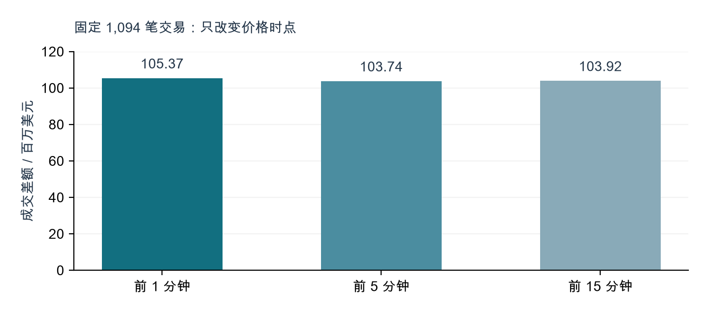
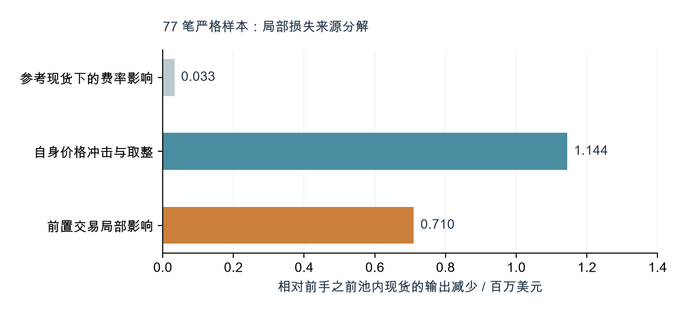
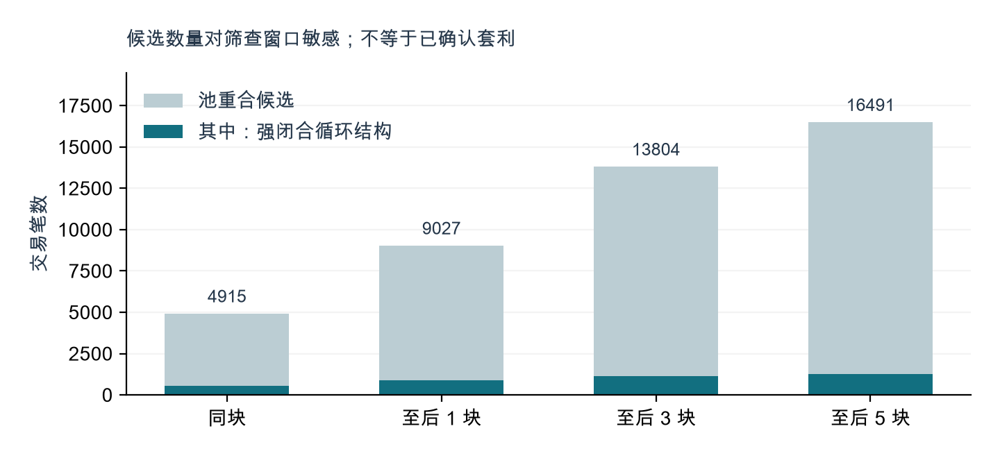

# 急迫兑换如何损失价值？
Binance 事件中的 MEV 与收益归属

FT565 · Group 12 / Flashbots & MEV
研究截止：2026-11-05 16:15:35 UTC

### 摘要

本项目检验老师提出的机制：为逃避冻结而急迫兑换稳定币，是否造成 DEX 价格背离、套利机会及 Gas 竞争，并量化资金损失与收款去向。研究结合连续区块回执、完整内部调用、历史状态、公开 relay 和交易前行情，分别估计成交差额、地址收支及局部排序影响，避免三者重复累计。

在已识别的 1,352 笔 Ethereum 兑换候选中，1,190 笔具备严格交易前行情，成交差额合计 1.0676 亿美元。固定 1,094 笔共同样本改用提前 5 或 15 分钟价格，结果仅分别下降 1.54% 和 1.37%。对 77 笔通过精确复现的 V2 样本，前置交易局部影响约 71.02 万美元，自身价格冲击与取整影响约 114.42 万美元。

| 研究量 | 独立核算结果 | 解释边界 |
|---|---|---|
| 成交差额 | 1.0676 亿美元 / 1,190 笔 | 包括冲击、费用、基准差和排序影响 |
| 前置交易影响 | 71.02 万美元 / 77 笔 | 固定输入的局部反事实；不是全事件总额 |
| 配对结构净现金流 | 27.43 万美元 / 260 组 | 已扣 Gas；地址边界与其他持仓仍有限制 |
| 结算资产去向 | 1,351 笔逐笔对平 | 包含池库存、协议资产；不是最终利润 |

### 核心判断

价格背离和费用竞争有直接证据；将全部成交差额视为 MEV、或认为套利者无成本赚取每 ETH 800 美元，均不成立。全事件因果 MEV 与全部受益人净利润尚不能由当前公开证据唯一识别。本项目交付可复核的估计对象、局部机制检验与资金流账，而不以无法证实的精确数字替代这一结论。

金额均为美元，另注明 ETH/USDT 者除外。严格行情指交易前已结束一分钟的收盘价。所有时间为 UTC。

## 1 / 研究设计与数据边界

### 研究问题与可检验预测

| 假设 | 检验方式 | 反证或限制 |
|---|---|---|
| H1：急迫兑换出现不利成交 | 净付出资产与净收入资产按事前市场价格比较 | 报价陈旧、同名资产及迁移会影响估值 |
| H2：交易排序进一步减少目标输出 | 官方 V2 池、实际输出精确复现，移除紧邻前手 | 必须固定输入；不代表全路线或行为均衡 |
| H3：套利竞争伴随费用上升 | 前一日同一 UTC 时段的费用与失败率比较 | 描述性对照，不排除其他市场冲击 |

### 样本构建

原连续窗口为 10 月 29 日 19:58:23 至 30 日 07:02:47：3,311 个区块、751,258 笔交易，回执与完整调用轨迹齐备。原窗口 1,172 笔兑换，加上后续地址日志筛查得到的 180 笔，构成 1,352 笔样本。后续不是整链连续扫描；最后观察到的候选兑换为 10 月 31 日 20:01:47。

55 个追踪线索地址与 FBI 的 608 个地址合并为 653 个。FBI 的“运营或密切关联”不代表共同所有权。已检查原窗口内部 ETH 活动；额外 FBI 地址仅原生币流与兑换样本不重叠。未知地址、其他链、仅原生币活动和截止后的交易仍可能未纳入。[R1-R2]

### 三个估计对象不得相加

成交差额 S(t) = -Σ 资产净变化 Δq(a,t) × 事前价格 p(a,t)。地址集合内部互转抵消；Gas 单列；四笔有利成交也保留，不只挑损失。策略现金流另外合并前后手、扣一次 Gas，并区分 WETH 包装、本金退回和债务变化。因果排序影响则比较指定反事实下的输出差。

### 关键假设

代币价格需要正确合约映射、可交易性和兑换代理假设；WETH/ETH 与 WBTC/BTC 代理明确保留。调用到的路由器不是共同所有权证明。全部策略仍可能存在窗口外或跨交易所头寸。链上金额自洽，不能单独证明经济利润或事件因果关系。

理论依据：MEV 包括交易纳入、排除及排序带来的可提取价值；交易排序竞争与费用竞价已有文献研究，但该机制不能替代本事件的识别设计。[R3-R4]

## 2 / 成交差额与稳健性

### 可解释的分母比“被盗总额百分比”更重要

严格样本 1,190 笔的净转出资产基准价值为 742,505,791.84 美元，差额占该分母 14.38%。这是样本兑换资产口径，不是 43 亿美元总被盗资产中的 MEV 比例。前十大交易贡献差额的 65.22%；剔除最大一笔后仍为 90,942,148.07 美元。

图 1｜同一批 1,094 笔交易；96 笔因某一时点缺价排除。三根柱不是不同覆盖范围的估计，也不是置信区间。来源：research_quality_analysis.json。

| 估值方案 | 交易笔数 | 成交差额 |
|---|---|---|
| 前一完整分钟 / 主样本 | 1,190 | 106,763,437.83 |
| 允许额外陈旧 5 分钟 / 扩样 | 1,322 | 108,876,568.72 |
| 预言机 + 后续 15 分钟 / 独立敏感性 | 1,351 | 109,167,538.78 |

### 价格身份与异常值核查

排除未获额外合约身份佐证的 15 笔旧 ERC-20 BNB 后，1,175 笔差额为 106,665,957.03 美元。FUN 已纠正为 Gate 的 FUNTOKEN 市场；PROM 的 ETH 合约另获官方目录佐证。跨交易所与现时目录佐证仍不能证明历史价格场所的全部可兑换条件。

最后一笔 DAR 因迁移缺可靠行情未置零。五分钟扩样和混合敏感性改变了覆盖样本，不能当作主结果上下界；固定样本图 1 才是价格时点敏感性。

## 3 / 局部反事实：损失来自哪里？

### 将“价格差”分成机制，而非统称 MEV

把严格反事实从原来的 70 笔扩展至 77 笔。251 个候选链接中，163 个因复杂或非标准路径排除，11 个因池身份未核实排除；77 个通过官方工厂、实际整数输出和储备连续性核验。

图 2｜固定相同目标输入，依次加入费率、自身有限交易量冲击及前置交易。基准为前手发生前池内现货，非 CEX 价格。来源：all_scope_v2_counterfactuals.json 与 research_quality_analysis.json。

### 精确分解的定义

令 x 为目标输入，X、Y 为前手之前输入/输出储备，q₀ = xY/X；q₁ = 0.997q₀；q₂ = floor(997xY / (1000X + 997x))；q₃ 为目标实际输出。则 q₀-q₃ = (q₀-q₁) + (q₁-q₂) + (q₂-q₃)。分别对应参考现货下的费率影响、自身冲击与整数取整、紧邻前手的局部影响。

三部分合计 1,887,398.76 美元，逐笔等式成立。这是按上述顺序定义的机制分解，不是 LP 实收手续费与套利者利润分配。不能再加到 1.0676 亿美元成交差额上。

### 选择偏差与解释边界

77 笔仅占已识别兑换的 5.70%，分布在 9 个池；最大五个局部效应贡献 73.79%。样本并非随机抽取，因此不按样本均值乘以 1,352，也不把 71.02 万美元称为全事件下限。保持输入意味着未重新决定路由、滑点保护、交易是否提交或其他参与者行为。

## 4 / 钱流向哪里：结算与最终收益

### 先完成资产账，再讨论利润

扩展后的 1,351 笔结算逐笔对平，1,332 笔全部对手方资产可估值；其余 19 笔保留未估值凭证或负债资产。下面是混合敏感性口径的已估值资产部分；部分资产相抵不意味着整个财富账已完成。

| 角色 | 资产净变化 / 百万美元 |
|---|---|
| 关联地址（含自身 Gas） | -109.2001 |
| 池库存 | 94.0347 |
| 其他地址 | 4.9631 |
| 当块费用收款地址 | 3.9581 |
| 已识别订单成交方 | 0.3367 |
| 借贷协议资产（未抵消债权） | 5.8924 |
| 基础费销毁 | 0.0307 |
| 铸销及包装对应项 | -0.0156 |
| 合计 | 0.0000 |

池库存增加 9,403.47 万美元是后续套利之前的资产变动，不等于 LP 的最终利润。借贷协议流入也需要减去债权/负债变化。销毁不属于任何人的收入。提议者转付与构建者流出重叠，不可重复相加。

### 可观察收益与地址归属

全部 16,491 笔候选已经分类。564 组前后手结构去重后，严格行情下 260 组无已识别仓位/债务事件且完整估值，净现金流合计 274,288.13 美元；五分钟行情覆盖 298 组，为 314,769.25 美元。发起地址、辅助地址、逐组交易哈希已列账，未推定真实个人身份。

141 个 V3 仓位已区分退回本金与记账手续费；可估值记账费约 60,946.89 美元。公开 relay 覆盖 2,939 块，其中 2,823 块实际付款路径匹配 10,394.91 ETH。这些是不同范围、可能重叠的现金流，均不能直接与表中池库存或策略收益相加。

案例警示：一组后手单看增加 567.68 ETH，合并前手后仅净增 12.08 ETH。“收到很多钱”与“赚了很多钱”不是同一件事。

## 5 / 候选筛查、Gas 与后续清算

图 3｜候选从同块 4,915 笔增至后五块 16,491 笔；强闭合循环结构分别为 569 和 1,278 笔。结构证据仍不等于因果套利。来源：candidate_window_sensitivity.json。

### 费用竞争：支持描述性关联，不宣称全部因果

| 指标 | 事件首段 | 前一日同时段 |
|---|---|---|
| 交易数 | 278,475 | 336,301 |
| 失败率 | 3.4836% | 1.0416% |
| 每笔平均 Gas / ETH | 0.010613481 | 0.000056224 |
| 基础费中位数 / gwei | 21.602142 | 0.088476 |
| 优先费 / ETH | 1,342.08 | 14.53 |

平均每笔 Gas 为对照的 188.77 倍。对照只对应最初约 4 小时 21 分钟；未采用多日或独立市场控制，不能将全部上升因果归于此次事件。Ethereum 已采用权益证明，论文使用“验证者/构建者”，不沿用老师假设中“矿工”的旧称。全连续窗口 Gas 中 1,794.18 ETH 被销毁，并非验证者所得。[R3]

### 后续清算必须单列

关联地址存入 6,000 万 USDT 并借出 19,762.41 WETH。11 月 4 日清算抵押物时，同时偿还 9,884.42 WETH；抵押物减少减去债务减少的市场价值为 1,065,933.81 美元，而非把抵押物移出全算损失。该清算与兑换样本交易不同，但清算损失同样不能全部称为排序 MEV。

## 6 / 回答老师：证据支持什么？

| 老师的命题 | 结论 | 最直接的证据 |
|---|---|---|
| DEX 约 3000，市场约 2200 | 存在对应不利成交；不可套用全资产 | 3,000 万 USDT 换 9,551.90 ETH：等效 3,140.74 USDT/ETH，事前市场 2,260 美元 |
| 套利者无成本赚取差价 | 不支持“无成本”及统一 800 美元利润 | 合并前后手、Gas、付款、库存与本金后，金额明显不同 |
| MEV 造成额外损失 | 局部样本支持 | 77 笔可复现排序影响约 71.02 万美元 |
| Gas 激增并让矿工获益 | 费用上升；收入主体与销毁需修正 | Gas 同期对照、relay 路径、销毁与优先费拆分 |
| 精确算出全事件 MEV | 当前证据不能唯一识别 | 未知范围、主体边界、未结头寸及全市场反事实仍有限制 |

### 与外部估计对照

Bitquery 的公开研究给出约 1.19 亿美元差额，并列交易者 5,990 万、构建者/验证者 2,950 万、LP 2,020 万、成交方 670 万美元；列出的四项合计 1.163 亿，不直接等于标题总数。它是外部估计，未独立复现其全部逐笔账，不将其作为本研究的实证总额。[R6]

### 本研究的贡献

第一，把成交差额、地址现金流与因果排序影响分开；第二，用同一批交易检验价格时点，而非把扩样误写成稳健性；第三，精确分解局部费用、价格冲击及前置影响；第四，提供实际收益去向和不可重复累计的会计边界；第五，保留缺价、排除理由与失败查询，使结论能够被推翻或复核。

### 边界不是免责条款

77 笔的选择偏差限制外推；未知地址和其他链限制总体覆盖；CEX 映射和陈旧行情限制估值；共享路由和窗口外头寸限制利润归属。这四类限制分别影响总体、价格、主体和反事实，不能通过增加候选数量自动解决。文中不给未经识别的总额置信区间，也不按 43 亿美元缩放样本比例。

## 7 / 复现路径与参考资料

### 如何在答辩时复核一个结论

复核金额：从全部兑换时间线.json 按交易哈希定位 strict 资产明细，核对 raw 数量、decimals、价格来源和时间戳。复核排序：在 all_scope_v2_counterfactuals.json 找到前手/目标储备、实际输出与移除前手输出，代入第 3 节整数公式。复核归属：在全范围策略发起者分配.json 沿 group_id 回到策略腿，核对 Gas 只扣一次。

本轮分析无需网络即可重算：运行 python3 research/reproduce_quality_upgrade.py。它重算新增反事实、固定样本稳健性与窗口敏感性，再运行质量检查。完整原始证据约 1.7 GB，按文件 SHA-256 编入 evidence_manifest.json；哈希证明文件一致性，不证明链上身份和因果假设。

| 关键证据 | 文件 |
|---|---|
| 新价格敏感性、分解、集中度 | research_quality_analysis.json |
| 77 笔局部复现与排除记录 | all_scope_v2_counterfactuals.json |
| 候选窗口选择 | candidate_window_sensitivity.json |
| 代币身份佐证 | price_identity_quality_audit.json |
| 全部结算分配、策略账 | all_scope_settlement_allocation.json；all_scope_strategy_valuation.json |
| 新增验证结果 | research_quality_validation.json |

### 参考资料与证据层级

- [R1 Binance，11 月 3 日事件通报](https://www.binance.bh/en/blog/community/3229153443759566763)
- [R2 FBI，关联地址与归因通报](https://www.fbi.gov/investigate/cyber/alerts/2026/north-korea-responsible-for-6-billion-binance-attack)
- [R3 Ethereum.org，Maximal extractable value](https://ethereum.org/developers/docs/mev/)
- [R4 Daian et al. (2019)，Flash Boys 2.0](https://arxiv.org/abs/1904.05234)
- [R5 Flashbots，Relay bulk data exports](https://collective.flashbots.net/t/flashbots-relay-bulk-data-exports-payloads-and-builder-submissions/700)
- [R6 Bitquery，Who profited（外部估计）](https://bitquery.io/investigations/binance-hack-who-profited)
主金额依据本地保存的历史区块、回执、trace、状态和行情响应。官方报告支持事件及地址背景；协议文档与论文支持机制；第三方文章仅作对照。各层证据不互相替代。
