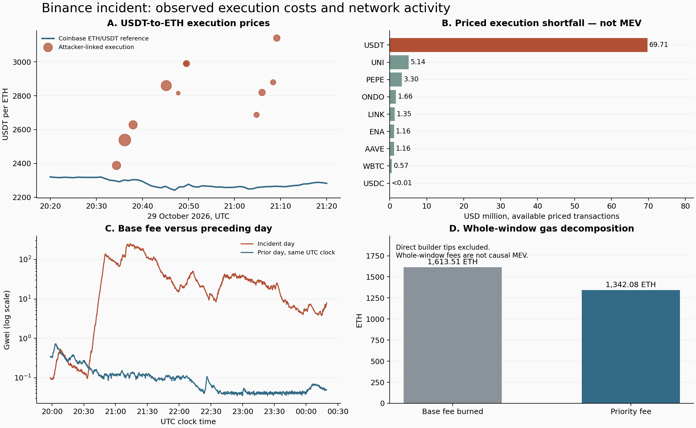

<!-- quality-upgrade -->
> **正式研究稿已更新：** 请优先阅读[正式研究报告](研究报告_正式版.md)。新增固定样本价格检验、77 笔局部反事实及机制分解、候选窗口与集中度敏感性。本文件保留为详细技术证据与历史范围记录；其中 70 笔结果是旧子样本。
<!-- quality-upgrade-end -->

<!-- event-completion-update -->
> **最新提交稿：** 已扩展至 1,352 笔 Ethereum 兑换候选、16,491 笔潜在套利交易，补入后续清算及前日 Gas 对照。请以[研究结论提交版](研究结论_提交版.md)为当前统一结论；本文件保留其指定窗口的历史分析。
<!-- event-completion-update-end -->

<!-- revenue-ledger-update -->
> **2026-11-05 收益与分配核算更新：** 已补齐全窗口 3,311 块调用轨迹，141 个 V3 仓位本金/手续费全部对平，配对结构完成更新估值，新增70笔局部反事实与地址分配账。请优先阅读[收益与分配总账报告](收益与分配总账报告.md)。这些分项不可相加为全事件 MEV 总额。
<!-- revenue-ledger-update-end -->

<!-- classification-update -->
> **新增经济含义核查：** 已对 13,623 笔候选分类，识别 LP 本金回收和前后手成本。旧现金流小计不能当作套利利润。详见[套利判定报告](套利判定报告.md)：一组后手增加 567.68 ETH 的案例，合并前手后净额为 12.08 ETH，并有局部反事实检验。
<!-- classification-update-end -->

<!-- candidate-gap-complete -->
> **候选收支缺口已补齐：12,934 → 0。** 全部 13,623 笔候选均有原生币收支证据。本轮 14 项核验通过。详见[缺口完成报告](候选收支缺口完成报告.md)及[中文逐笔明细](候选收支明细_中文.csv)。这项完成不代表全事件 MEV 因果核算完成。
<!-- candidate-gap-complete-end -->

<!-- extension-update -->
> **更新：后续扫描已延长至 10 月 30 日 07:02:47 UTC。** 连续检查 751,258 笔交易，新增 830 笔日志净流出均取得调用轨迹；候选扩大至 13,623 笔。新增严格样本执行差额为 7,820,474.84 美元。请先读 [后续时段补充报告](后续时段补充报告.md)；下文金额和覆盖数保留为原窗口结果，不能当作最新全窗口结果。
<!-- extension-update-end -->

# Binance 被盗资金兑换与 MEV：综合研究报告

更新日期：2026-11-04。金额以美元或 ETH 标注，时间全部为 UTC。

## 结论与完成状态

现有证据支持：攻击者关联地址的急迫兑换出现了明显的不利成交，相关池随后有大量反向交易，网络费用也显著高于前一天同一时段。但**目前仍不能把全部成交差额称为 MEV，也未独立完成整个事件的 MEV 收益分配对账**。

本次已从四笔案例扩展为连续 1,301 个 Ethereum 区块、278,475 笔交易。发现 417 笔带池兑换事件的关联地址净流出交易，另有 4 笔“代币转出、ETH 转入”的订单或其他成交待确认协议。328 笔具备当前估值条件的交易，相对选定市场基准的执行差额合计 **84,059,568.47 美元**；这不是全事件 MEV 总额，也不是其下限。

研究已有可复核的数据、时间线、计算、图表和限制说明；如果老师要求全链、全时段、可归因的 MEV 总额，目前仍未全部完成。不能把报告结构完整等同于实证覆盖完整。

## 1. 老师的问题应如何拆解

需要分别回答：哪些被盗资产被换掉、实际收到多少；相对市场基准损失多少；其中多少是正常交易费、自身价格冲击或排序相关价值转移；收益最终进入交易者、订单成交方、LP、构建者或验证者中的哪一类。

冻结、仍持有、内部搬运、借款抵押不能计作兑换损失。攻击者损失不是交易所损失的简单同义词：交易所先遭资产外流，攻击者后续兑换是另一层核算。

## 2. 事件时间线

| 时间（UTC） | 事件 | 证据性质 |
|---|---|---|
| 10-29 20:05–20:09 | XRP 热钱包异常转出 | Binance 事后通报 |
| 10-29 20:34:23–20:49:35 | 9 笔第三方发起的关联 USDT 支出，共 325,000,000 USDT，收到 122,316.323922299741513724 ETH | 本次回执与内部转账复核；不能据发起人不同漏掉订单 |
| 10-29 20:47:47 | 额外一笔 10,000,000 USDT 直接路由兑换，收到 3,552.228717651589845452 ETH | 本次复核 |
| 10-29 20:57:59、21:00:11 | 10,000,000 和 50,000,000 USDT 存入 Aave | 本次日志；归为借贷而非出售 |
| 10-29 21:04:47–21:09:11 | 原四笔合计 100,000,000 USDT，收到 34,582.882307640749315305 ETH | 本次复核，与旧样本一致 |
| 10-29 晚间 | RLUSD、UNI、PEPE、LINK、AAVE、WBTC、ENA、ONDO、USDe 等继续流出并兑换 | 本次连续窗口台账 |
| 10-29 23:56 | 最后一笔未经授权的 ETH 转出最终确认 | Binance 事后通报；不是兑换停止时刻 |
| 10-30 00:10 | 撤销 Binance14 的恶意授权 | Binance 事后通报 |
| 10-30 00:19:23 | 本次 Ethereum 独立连续扫描的结束点 | 此后的出售和套利不在本次独立核算中 |

Binance 的 11 月 3 日通报将受影响资产列为约 63.4 亿美元，冻结或拦截约 28.5 亿美元。老师截图中的早期金额与事后通报应保留各自时点，不能混为同一口径。[Binance 通报](https://www.binance.bh/en/blog/community/3229153443759566763)

完整交易时间、哈希、资产净流量及估值状态见 [交易级时间线](交易级时间线.md)。

## 3. 覆盖范围与证据来源

主窗口为 2026-10-29 19:58:23 至 10-30 00:19:23，区块 26,300,640–26,301,940。全部区块和回执已取得，并核对每块的交易数量及区块哈希，没有下载缺块。**100% 是这个预先记录窗口的区块读取覆盖率，不是全事件或被盗金额覆盖率。**

老师提供的追踪器包含 228 个跨链地址条目；其中 55 个 Ethereum 攻击方角色地址用作最初线索。[追踪器](https://binance.lamps.works/?tab=breakdown)

另外提取了 FBI 通报连续列出的 608 个 Ethereum 地址。它们与 55 个线索地址重合 10 个，合并为 653 个。在当前窗口的交易发起人、接收人及 ERC-20 日志中，没有发现额外 598 个地址的活动。这个检查不覆盖仅在内部 ETH 转账中出现的地址。FBI 的措辞包括“运营或密切关联”，不能把整张名单视作同一所有人。[FBI 通报](https://www.fbi.gov/investigate/cyber/alerts/2026/north-korea-responsible-for-6-billion-binance-attack)

本次共补齐 526 笔所选交易的内部 ETH 收支，含 433 笔关联地址代币净流出记录和原 93 笔候选。Etherscan 页面数据与 Blockscout 分页内部调用互为补充；四笔原始兑换跨来源一致。这仍属于公共浏览器数据，不是自建节点的独立执行回放。

## 4. 兑换损失的独立计算

对每笔交易，把地址集合流向外部的资产按参考价估值，减去流入资产的参考价值；同一集合内部搬运抵消。ETH 内部收支、顶层交易 value、WETH Deposit/Withdrawal 分开处理。Gas 单独列示，不包含在下面的执行差额中。

`执行差额 = 转出资产的基准价值 − 收到资产的基准价值`

主要参考价取 Coinbase **交易前一个完整分钟**的收盘价，避免使用尚未结束的分钟；USDT 使用其美元报价，不机械等于一美元。USDC/DAI 按一美元是假设，WBTC 使用 BTC 报价是代理，两者在逐笔结果中明确标记。价格字段遵循官方 K 线定义。[Coinbase 说明](https://docs.cdp.coinbase.com/api-reference/exchange-api/rest-api/products/get-product-candles)

| 转出资产 | 已识别兑换笔数 | 已估值笔数 | 市场基准差额（美元） |
|---|---:|---:|---:|
| USDT | 17 | 17 | 69,708,190.02 |
| RLUSD | 10 | 0 | 未估值，不能记作零 |
| UNI | 42 | 42 | 5,140,472.87 |
| PEPE | 94 | 94 | 3,303,078.16 |
| USDC | 28 | 28 | 1,072.92 |
| LINK | 89 | 89 | 1,348,575.89 |
| AAVE | 14 | 14 | 1,157,877.35 |
| WBTC | 3 | 3 | 573,651.57 |
| ENA | 12 | 12 | 1,162,561.31 |
| USDe | 83 | 0 | 未估值，不能记作零 |
| ONDO | 29 | 29 | 1,664,088.39 |

可估值部分合计 **84,059,568.47 美元**。将前一分钟的高低价用于保守组合，敏感性范围为 **82,049,719.06–85,775,622.09 美元**。这只反映所用分钟内价格选择，不是统计置信区间，也不覆盖所有模型误差。

其中，9 笔第三方发起的大额 USDT 成交的执行差额约 45,750,375.98 美元；5 笔关联地址自己发起的大额兑换约 23,957,684.29 美元。仅按交易发起地址筛选，会遗漏前一组 3.25 亿 USDT 的成交。

48,000,000 RLUSD 的 10 笔出售已经核实收到 20,493.834501855856787902 ETH，但未取得合适的独立历史 RLUSD 价格，主结果保留“未估值”。USDe 的 83 笔同理；其中有先换 USDC、再换 ETH 的多段交易，不能只看 ETH 收款为零便判为全损。

## 5. MEV 候选与可核算的账户收益

扫描使用 V2/V3/V4 兼容 Swap 事件。V4 按 PoolManager 地址加 pool ID 区分池，不能把整个管理合约当作单一池。事件签名匹配本身不证明合约来自官方工厂。[V2 接口](https://raw.githubusercontent.com/Uniswap/v2-core/master/contracts/interfaces/IUniswapV2Pair.sol)、[V4 接口](https://raw.githubusercontent.com/Uniswap/v4-core/main/src/interfaces/IPoolManager.sol)

识别出 101 个关联兑换触及的池；整个窗口内 30,820 笔交易触及这些池。以同块或随后五块出现共同池为候选条件，得到 **8,548 笔**，其中 2,213 笔与某个前序目标同块，6,985 笔出现过相反方向的 amount0。这些集合相互重叠，不能相加，也不能全部标作套利。

原先 93 笔候选已全部补齐内部 ETH 数据。暂按“发起地址 + 顶层调用地址”为账户边界，其中 58 笔没有其他 ERC-20 净库存变化，ETH/WETH 扣 gas 后净额合计 **10.320128732244681558 ETH**。其余 35 笔存在其他代币库存，不能只把 ETH 余额变化叫利润。即使库存闭合，也可能遗漏第三方利润接收地址、共享路由器、链外对冲和所有权关系，所以这个合计是账户边界结果，不是已证明的事件 MEV。

93 笔交易中，区块 fee recipient 的内部 ETH 净入账合计 **148.723299335006232385 ETH**，与优先费分开。这是接收地址层的现金流，不代表构建者最终留存，也不能与其向验证者转付的钱重复相加。

复核纠正了旧人工记录的一处 999 wei 差额：遗漏了策略合约对应的内部 ETH 净支出。金额极小，但已记录在 `accounting_corrections.json`，并据此更新旧样本。Etherscan 的 ETH 净额展示包含顶层 value，Blockscout 内部调用不包含；本次按来源分别处理。此前六笔人工检查案例均有路径支持；新表不把它们直接推广到全体。全体 8,548 笔的内部转账、主体归并、库存定价及反事实归因仍未做完。详见 [原 93 笔收支附表](候选收益附表.md)及 `expanded_candidates.json`。

## 6. Gas、销毁与区块生产收入

| 指标 | 主窗口结果 |
|---|---:|
| 所有交易 gas 支出 | 2,955.589181 ETH |
| 其中基础费销毁 | 1,613.509154 ETH |
| 其中优先费 | 1,342.080027 ETH |
| 失败交易 | 9,701 笔 |
| 失败交易 gas 支出，已包含在总 gas 中 | 271.095611 ETH |
| 前一天同一 UTC 时段的基础费销毁 | 4.377899 ETH |

主窗口基础费销毁是前一天同一时段的约 368.6 倍。该对照取得 1,303 个区块头；回执接口返回 null，因此前一天的失败交易数、优先费及直接小费仍未知。单一前日不是充分的因果控制组。

8,548 笔候选的 gas 共 898.543401 ETH，其中基础费 222.518665 ETH、优先费 676.024736 ETH。这是候选集合的费用，不是确认的套利费用。失败交易成本已计入全窗口，不能再额外加一次。

基础费被销毁，不是任何构建者所得。构建者接收优先费和直接付款后，可能再转付验证者；全窗口还观察到 fee recipient 发起的有金额顶层转账，但未把它们全部归类为验证者报酬。因此不能将“gas + 小费 + 验证者收款”简单相加。

## 6.1 TRON：补充的跨链独立复核

对追踪清单中的 46 个 TRON 地址读取 2026-10-29 20:00 至 10-30 20:00 的分页交易历史，去重后 1,307 笔。取其中由关联地址发起的 89 笔智能合约调用取得交易信息：87 笔成功、2 笔失败，下载没有遗留错误。第三方发起、仅通过内部调用触及关联地址的交易可能遗漏。

10 月 29 日 20:47:27–21:14:12，16 笔大额 USDT 支出共 **234,000,000 USDT**，收到 **638,172,758.693694 TRX**，实际记录费用共 107.647000 TRX。14 笔有已识别的 Swap 兼容事件；另 2 笔为同一路由器、USDT 转出及 TRX 转入，但需补充底层事件 ABI，不将这两笔称为已完成协议级解码。

Bitfinex TRX/USD 分钟现货与 Coinbase USDT/USD 基准得到 **22,195,696.92 美元**执行差额。Bitfinex 某些分钟没有交易，因此使用最近已结束的分钟，实际陈旧程度为 0–240 秒；这与 Ethereum 严格前一分钟口径不同。使用相应 K 线高低价时为 21,946,624.97–22,550,764.60 美元，但这个范围不覆盖陈旧报价误差。前一个完整小时的 Kraken 价格作粗略对照，结果 22,541,129.12 美元。这里均未计算 TRON 套利者/LP 的完整收益。[Bitfinex K 线说明](https://docs.bitfinex.com/reference/rest-public-candles)、[Kraken K 线说明](https://docs.kraken.com/api-reference/market-data/get-ohlc-data)

另发现一笔 100 USDT 的后续小额 TRX 买入，未纳入上述 16 笔大额小计；借贷存入和纯转出单列，未算作兑换。逐笔表见 [TRON 核查](TRON核查.md)。地址历史及内部交易字段参考 [TRON 官方接口](https://developers.tron.network/reference/get-transaction-info-by-account-address)。

两条链各自限定样本的 344 笔可估值成交差额，按各自明示基准相加为 **106,255,265.39 美元**。这只是异质基准下的样本合计，不是完整全事件损失，不是可归因 MEV，也不应与第三方总数相加。

## 7. 全事件外部估计与对账问题

Bitquery 的公开研究将全事件相对市场价格的差额估为约 **1.19 亿美元**，并列出交易者净所得 5,990 万、构建者/验证者 2,950 万、LP 2,020 万、订单成交方 670 万美元。这些是第三方估计，本项目没有独立复现其完整账本。[Bitquery 研究](https://bitquery.io/investigations/binance-hack-who-profited)

有一处必须保留的审查问题：上述四项合计 1.163 亿美元，与 1.19 亿相差约 270 万；原文另称未追踪约 450 万美元。仅凭公开摘要无法闭合，需要四个分账本解释范围、净额和重叠。不能自行把差额塞进某个参与者，或把全文数字画成已经平衡的资金流图。

本次估值与外部研究的时间窗口、市场、现货/期货代理和稳定币定价不同。即使数量级接近，也不能把差值当作新增损失，更不能把本次结果与外部总数相加。

## 8. 因果识别与尚未解决的部分

成交差额包含自身价格冲击、LP/协议费、急迫接受订单折价、已有价差及排序相关机会；要识别严格 MEV，需要明确反事实。例如固定同一交易的规模和路由，在目标前状态与去除指定排序交易后的状态分别执行，再比较其净到账。只删除一笔套利交易会改变随后状态，必须说明哪些交易重放、哪些订单可能不再成交。

本报告没有完成该反事实回放，因而不给出一个伪精确的“全事件 MEV 损失”。LP 需要头寸和费用增长数据，订单成交方需要借款及链外库存成本，构建者/验证者需要最终支付链。冻结与余额需要独立资金守恒表，不能从兑换台账反推。

目前尚缺：Ethereum 00:19:23 之后及未发现地址的兑换；全体候选完整收益；LP 和订单方的完整账本；跨链与链外库存；统一全事件对账及严格反事实检验。`trace` 批量读取接口的访问限制是其中一项困难，但不是把其余缺口隐藏起来的理由。

## 9. 推荐的研究顺序与验收条件

1. 固定时间、链、地址来源和研究问题，先交付可以逐条追溯的时间线。
2. 建立被盗资产、内部转账、冻结、借贷、兑换与余额的守恒台账；以交易和日志为入口，不只看发起人。
3. 先核对每笔兑换输入、输出和费用，再选择历史市场价格及敏感性方案。
4. 逐笔筛选池和订单成交方，结合跨池路径、交易顺序和库存变化判断候选。
5. 把交易者、LP、成交方、构建者、验证者、销毁分账，消除内部支付重复。
6. 做正常时段对照、替代价格及反事实子样本；未定价或无法归因部分保持未知。
7. 只有当覆盖率分母、收益总表、未解释余额及主要假设可核查时，才能宣布全事件核算完成。

## 10. 复核材料

- `window_ledger.json`：1,317 笔地址线索活动及区块扫描状态。
- `expanded_valuation.json`：433 笔代币净流出逐笔分类、定价、假设与缺口。
- `native_evidence.json`、`etherscan_raw/`、`blockscout_raw/`：所选 526 笔内部 ETH 收支及来源。
- `expanded_candidates.json`、`candidate_accounting_93.json`：候选集合与已做账户核算部分。
- `window_raw/`、`baseline_raw/`：连续区块/回执及对照日区块头。
- `window_price_sources.json`、`prices_raw/`：历史价格来源与原始 K 线。
- `address_scope_audit.json`、`fbi_eth_addresses.json`：扩展地址核对。
- `validation_results.json`：重复哈希、费用守恒、旧样本回归及来源一致性检查。

所有原始来源可用于复核事实；浏览器标签不等于法律主体确认，普通交易或套利获利也不等于参与盗窃。
